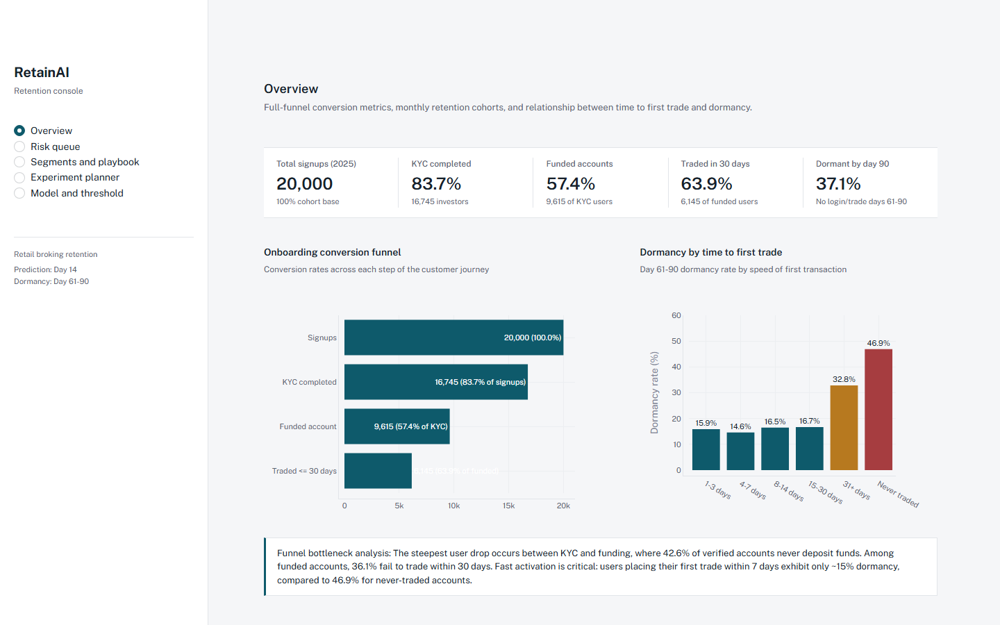
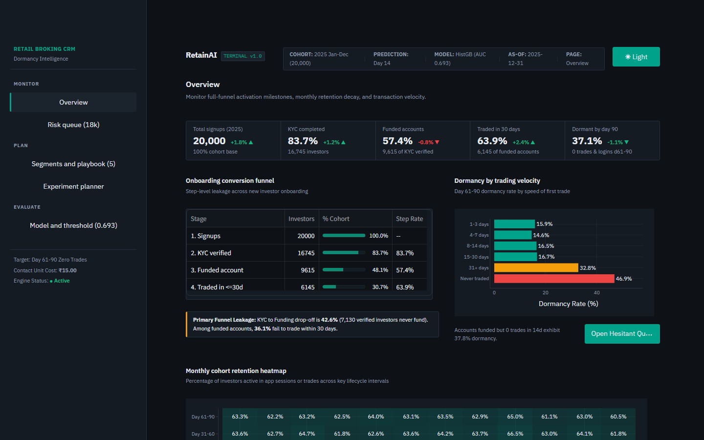
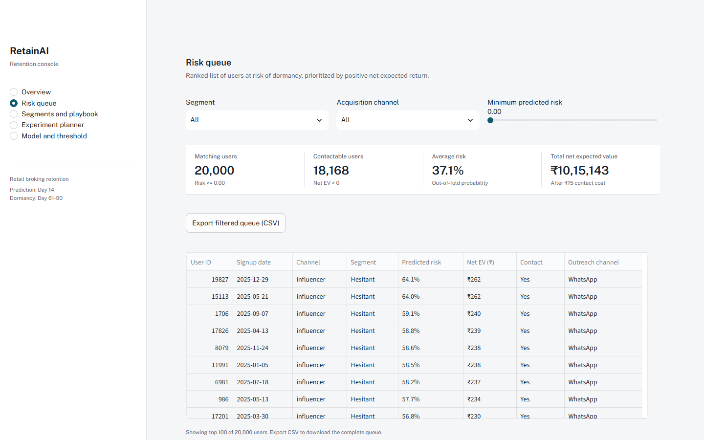
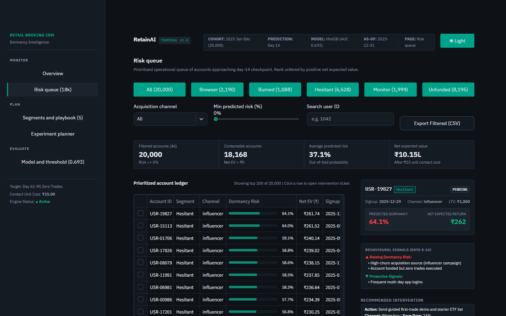
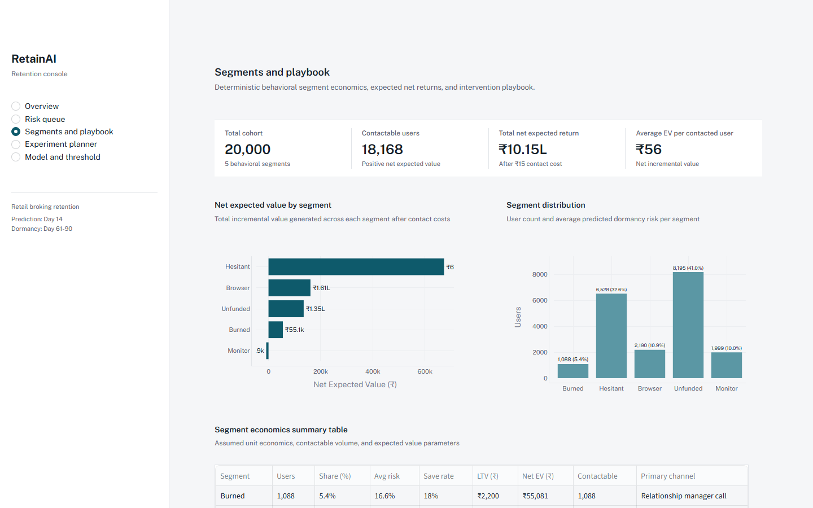
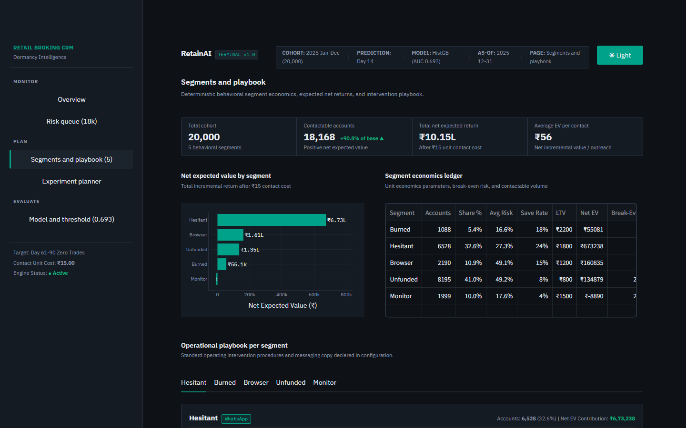
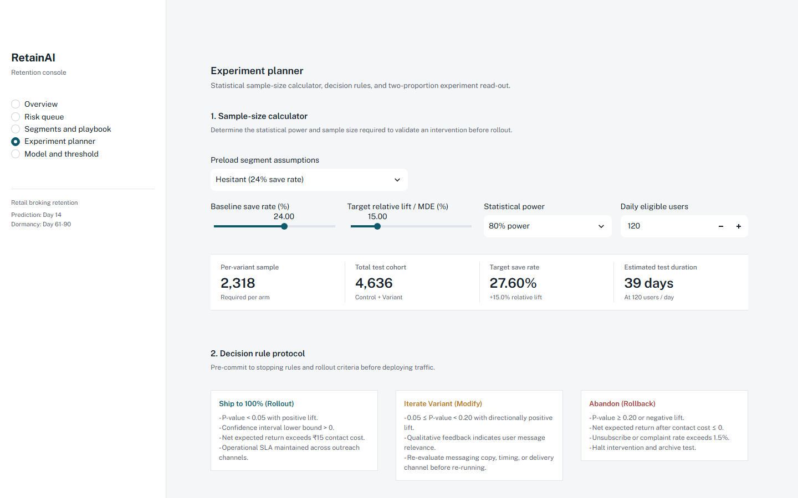
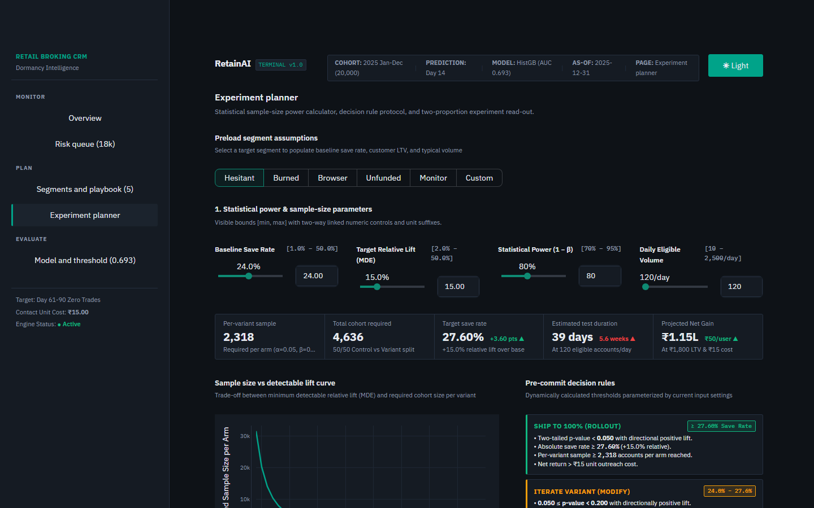
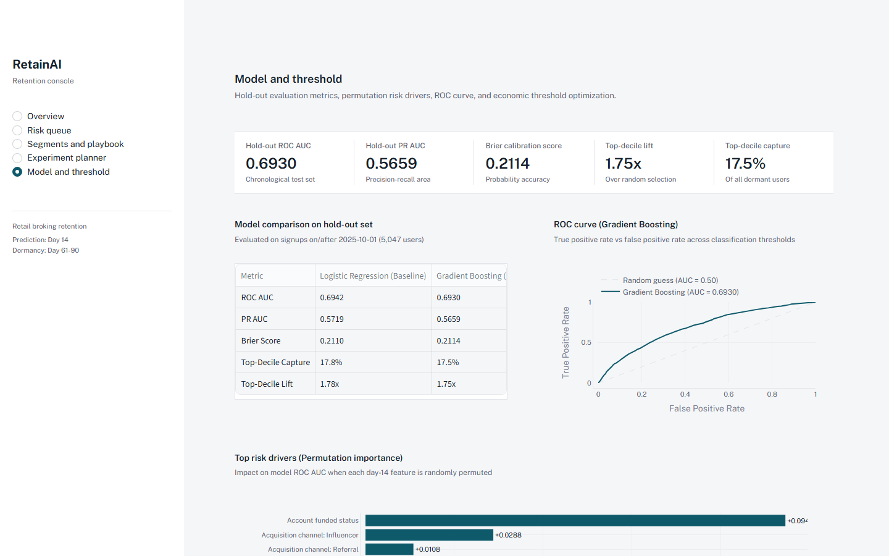
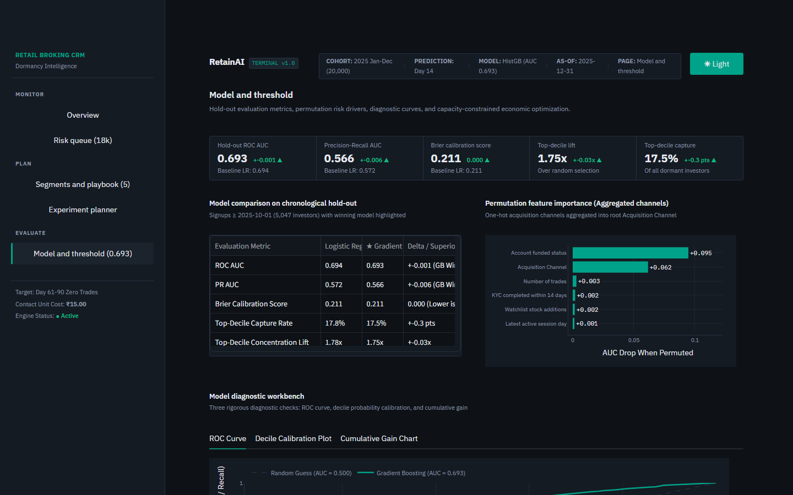

# RetainAI: Retail Broking Retention Console

Institutional trading terminal and retention triage console for retail brokerage operations. Built for retention PMs and CRM analysts monitoring new investor activation, early disengagement, and day-14 risk interventions.

---

## Live Access Links

- **Instant Public HTTPS Tunnel:** [https://wireless-behavioral-guides-ate.trycloudflare.com](https://wireless-behavioral-guides-ate.trycloudflare.com) *(Cloudflare Tunnel)*
- **Local Terminal URL:** [http://localhost:8501](http://localhost:8501)

---

## Before & After Gallery (Terminal Redesign)

| View | Baseline ("Before") | Institutional Terminal ("After") |
| :--- | :--- | :--- |
| **Overview (Command Centre)** |  |  |
| **Risk Queue (Master & Detail)** |  |  |
| **Segments & Playbook** |  |  |
| **Experiment Planner** |  |  |
| **Model & Threshold** |  |  |

*Full screenshot suites across 1920×1080, 1440×900, and 1280×720 for both Dark and Light themes are cataloged in [`docs/after/`](docs/after/).*

---

## Key Institutional Terminal Capabilities

### 1. Unified Telemetry Shell & Dual Themes
- **Trading Terminal Aesthetics:** High-density 8px grid, tabular numbers, monospace IDs, and zero decorative gradients or animations. Inspired by Zerodha Kite, Upstox Pro, and Bloomberg Terminal.
- **Dual Themes:** Default Dark Terminal (`#0E1217` canvas, `#151B23` panel, `#0E8A73` teal accent) and Clean Light Theme (`#F4F5F7` canvas, `#FFFFFF` panel). Instant toggle in top telemetry bar.
- **Top Telemetry Strip:** Real-time ticker displaying Cohort Period, Prediction Checkpoint (Day 14), Model Version (HistGB), Evaluation Cutoff, and Page Location.
- **Left Rail Navigation:** Grouped rail (`MONITOR`, `PLAN`, `EVALUATE`) with active-state indicator bars, count pills (`18k`, `5`, `0.693`), and zero radio bullets.

### 2. Command Centre Overview ([`app/views/overview.py`](app/views/overview.py))
- **5-Figure Fixed Metric Strip:** Total Signups, KYC Completed, Funded Accounts, Traded $\le$ 30 Days, and Dormant by Day 90 with 3-month trailing delta trends.
- **Hybrid Funnel Ledger:** Stage count, % of cohort, and step conversion rate with the primary onboarding leak highlighted.
- **Trading Velocity Analysis:** Horizontal bar breakdown of dormancy rate by speed of first trade with direct CTA button routing immediately to the Hesitant queue.
- **Monthly Cohort Heatmap:** Uniform green matrix tracking Day 31-60 and Day 61-90 retention decay across calendar cohorts.

### 3. Master-Detail Risk Queue ([`app/views/risk_queue.py`](app/views/risk_queue.py))
- **Segment Triage Tabs:** Quick filtering across Hesitant, Burned, Browser, Unfunded, and Monitor segments with live account count pills.
- **Master Table:** 65% width data grid with inline risk bars, colored segment tags, and row selection. All-"Yes" contact column eliminated.
- **Intervention Ticket Order Drawer:** 35% sticky right-hand panel modeled on a trading order ticket:
  - User summary and visual risk meter.
  - **Polarity-Corrected Driver Analysis:** Distinctly separates factors pushing risk up (▲ Raising Risk) from protective retention activity (▼ Protective Signals).
  - Recommended action and delivery channel.
  - Live editable message copy preview.
  - Triage actions (**Approve Batch**, **Skip Account**, **Snooze 7 Days**) with session state counters and approved-only CSV export.

### 4. Segments & Economics Ledger ([`app/views/segments_playbook.py`](app/views/segments_playbook.py))
- **Authoritative Economics Engine:** Centralized in [`src/economics.py`](src/economics.py) guaranteeing ₹10.15L Total Cohort Net EV consistency across all views.
- **Segment Economics Ledger:** Clean unit economics table with no truncated columns (`Accounts`, `Share %`, `Avg Risk`, `Save Rate`, `LTV`, `Net EV`, `Break-Even Risk R*`, `Channel`).
- **Horizontal EV Distribution:** Horizontal bar chart with outside gutter labels and negative-value offset.
- **Integrated Playbook Container:** Segment rules, economic assumptions, operational actions, and message copy unified in a single container card.

### 5. Experiment Planner ([`app/views/experiment_planner.py`](app/views/experiment_planner.py))
- **Segmented Control:** Rapidly preloads segment parameters or custom baseline assumptions.
- **Linked Units & Bounds:** Dual slider + number input controls with explicit unit suffixes (`%.1f%%`, `%d accounts/day`).
- **Sample Size vs MDE Power Curve:** Interactive curve with current operational setting marked.
- **Dynamic Decision Rules:** Pre-committed `SHIP TO 100%`, `ITERATE VARIANT`, and `STOP & ARCHIVE` protocols dynamically populated with current threshold values.
- **Two-Proportion Test Read-Out:** Trial results evaluation reporting relative lift, confidence intervals, p-value, and an institutional verdict badge.
- **Markdown Export:** Instant download of a complete experiment pre-registration brief (`.md`).

### 6. Model & Capacity Threshold Optimizer ([`app/views/model_threshold.py`](app/views/model_threshold.py))
- **3-Decimal Precision:** Hold-out metrics (ROC AUC `0.693`, PR AUC `0.566`, Brier `0.211`) formatted strictly to 3 decimals with baseline deltas.
- **Aggregated Channel Importances:** One-hot channel features aggregated into root `Acquisition Channel` (+0.062 AUC drop).
- **3-Tab Diagnostic Workbench:** ROC Curve, Decile Probability Calibration Plot ($y=x$ ideal benchmark), and Cumulative Gain Chart.
- **Capacity-Constrained Optimizer:** Replaces unconstrained 100% recommendations with operational CRM capacity limits:
  $$\text{Cutoff} = \min(N_{\text{breakeven}}, \text{Weekly Capacity})$$
  Reports operational regime, marginal account Net EV, and cumulative EV curve with cutoff marker.

---

## Quickstart & Runbook

### 1. Install Dependencies
```bash
pip install -r requirements.txt
```

### 2. Run Pipeline (Synthetic Generation, DB Build, Training, Scoring)
```bash
python -m src.pipeline
```

### 3. Run Test Suite
```bash
pytest
```
*Current status: **19 passed in 4.40s** (including end-to-end `AppTest` on all views).*

### 4. Launch Local Terminal
```bash
streamlit run app/main.py
```
Open **`http://localhost:8501`** in your browser.

### 5. Launch Cloudflare Public Tunnel (Optional)
```bash
.\scratch\cloudflared.exe tunnel --url http://localhost:8501
```

---

## Test Verification Summary

```text
tests/test_economics.py ....                                            [ 21%]
tests/test_leakage.py ..                                                [ 31%]
tests/test_segments.py ..                                               [ 42%]
tests/test_stats.py ..                                                  [ 52%]
tests/test_train.py ..                                                  [ 63%]
tests/test_views.py .......                                             [100%]

============================= 19 passed in 4.40s ==============================
```
